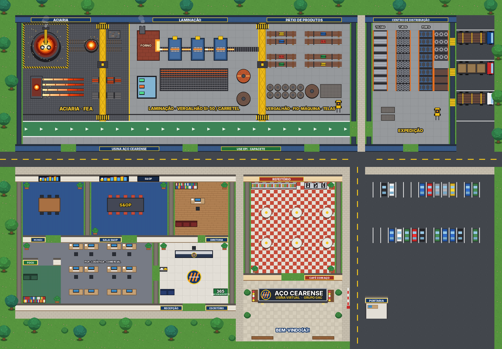
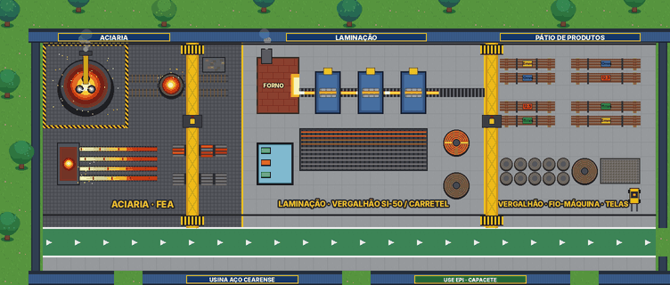

# Usina Aço Cearense – mapa para WorkAdventure

Mapa 2D de uma usina siderúrgica para usar no [WorkAdventure](https://workadventu.re).





## Como usar no WorkAdventure

1. No painel `admin.workadventu.re`, abra o mundo, clique em **New Room** (ou edite uma sala) e escolha **Custom map**.
2. No campo **URL of your custom map**, cole:

```
https://raw.githubusercontent.com/SamuelBandeira1/teste_ggp/ccr-8ea0acaa-n1gvpy/map.json
```

Se essa URL não for aceita, use esta, que passa pelo CDN do jsDelivr:

```
https://cdn.jsdelivr.net/gh/SamuelBandeira1/teste_ggp@ccr-8ea0acaa-n1gvpy/map.json
```

Quando a branch for mesclada na `main`, troque `ccr-8ea0acaa-n1gvpy` por `main` na URL.

## O que tem no mapa

| Área | Detalhes |
|---|---|
| **Aciaria** | Forno elétrico a arco, panela de aço líquido nos trilhos, lingotamento contínuo e tarugos quentes |
| **Laminação** | Forno de reaquecimento, cadeiras de laminação, leito de resfriamento, carretéis (spooler) e cabine de controle |
| **Pátio de produtos** | Feixes de vergalhão por bitola, fio-máquina, telas e empilhadeira |
| **Centro de Distribuição** | Porta-paletes de telhas, tubos, perfis e arames, docas e carretas carregadas |
| **Escritório** | Sala de Reunião, **Sala S&OP**, Diretoria, escritório aberto (PCP, Logística e Comercial), Área de Foco e Recepção |
| **Refeitório** | Buffet, "Café com Aço" e mesas |
| **Entrada** | Letreiro "AÇO CEARENSE", praça de chegada (ponto de entrada), portaria e estacionamento |

Pontes rolantes e copas das árvores ficam **por cima** do personagem.

### Animações

O mapa usa tiles animados do Tiled (8 quadros de 150 ms):

- fogo do forno elétrico, da panela, do lingotamento e do forno de reaquecimento tremulando;
- arcos elétricos entre os eletrodos e faíscas;
- fumaça saindo das chaminés;
- brilho correndo na barra quente, cilindros da laminação e carretel girando;
- talha das pontes rolantes indo e voltando, com luz piscando;
- giroflex das empilhadeiras, setas andando na passarela;
- vapor das máquinas de café e cursor nos gráficos da sala S&OP.

### Áreas interativas

- **Sala de Reunião**, **Sala S&OP** e **Diretoria**: abrem uma videochamada (Jitsi) quando você aperta ESPAÇO dentro da sala.
- **Área de Foco**: zona silenciosa, onde ninguém abre conversa com você.
- **Cabine de Controle** e **Letreiro**: a câmera dá zoom ao entrar.

## Editar o mapa

A arte é original e gerada por código. Para mudar algo:

```bash
pip install pillow
python3 tools/gerar_mapa.py
```

O script recria `map.json`, `tileset.png` e `preview.png`. O `map.json` também abre no [Tiled](https://www.mapeditor.org/).

Camadas: `chao` (piso e objetos), `colisoes`, `start` (ponto de entrada), `areas` (salas), `floorLayer` (personagens) e `acima` (o que fica por cima dos personagens).
